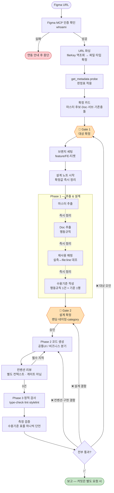

# figma-to-component — Figma → 컴포넌트 생성 워크플로우 (운영 매뉴얼)

> 팀 공유용 **오리엔테이션**. 여기서 잡는 것: **왜/언제 쓰나 + 전체 흐름 + 놓치기 쉬운 규율**.
> 단계별 절차의 **단일 원본은 `SKILL.md` + `docs/*`**다(각 섹션 📄 링크). 이 README는 절차를 재서술하지 않는다 — 드리프트 방지.

---

## 목차

1. [개요 — 이게 뭐고 언제 쓰나](#1-개요--이게-뭐고-언제-쓰나)
2. [전체 흐름](#2-전체-흐름)
3. [항상 열리는 게이트는 2개 — 무엇을 묻고 무엇을 안 묻나](#3-항상-열리는-게이트는-2개--무엇을-묻고-무엇을-안-묻나)
4. [Phase별 절차 — 원본 링크 맵](#4-phase별-절차--원본-링크-맵)
5. [레퍼런스 · 파일 구조](#5-레퍼런스--파일-구조)

---

## 1. 개요 — 이게 뭐고 언제 쓰나

**한 줄 정의**: Figma 디자인을 분석해 React 컴포넌트로 만드는 워크플로우. **기존 `src/pui/*` 재사용을 우선**하고, 없는 것만 신규 생성한다.

**설계 철학**: **입력은 Figma URL 하나면 된다.** 파일 타입·마스터·Doc 시트·서브 세트 id·기존 구현 충돌은 전부 `get_metadata` probe로 **도출**된다. 사람에게 묻는 건 **도구가 알 수 없는 것**뿐이다.

> **질문의 존재 근거는 "스킬이 그 값을 알 수 없다"여야 한다.**
> **"스킬이 틀릴 수 있다"는 질문의 근거가 아니다** — 그건 근거 표기 + 반증 가능한 선택지로 처리한다.

**범위와 경계**:

| 항목 | 내용 |
|------|------|
| 한다 | 인테이크 → 추출 → 설계 → 코드 생성 → 컨벤션 리뷰 → 검증. 공통 UI는 스토리·README changelog 초안까지 |
| 안 한다 | 커밋(`/git-commit`), 디자인 배포, 팀 합의, PR·리뷰 |
| 대상 레포 | fe-mobile — `src/pui/` · `src/features/` · `src/apps/` · `src/styles/theme.ts` |
| 컨벤션 기준 | **PUI 코드 컨벤션**(pui 기본) · **프로젝트 코드 컨벤션**(프로젝트 저장소 `CLAUDE.md`/`AGENTS.md`)(전사) · `docs/build/guide/*`(생성 부가) |

**언제 태우나 vs 다른 스킬로**:
- ✅ **f2c로**: 컴포넌트 **신규 생성**. Figma 명시 여부·pui/도메인 여부와 무관하게 발동한다.
- ❌ **대상 아님**: 기존 컴포넌트 리뷰·수정 · 레거시 분석 · pui↔Figma 정합 진단.

📄 원본: `SKILL.md`

---

## 2. 전체 흐름



**핵심 포인트**
- **항상 열리는 게이트는 2개**(Gate 1 대상 확정 / Gate 2 설계 확정). 나머지는 probe로 도출한다.
  - 조건부로 붙는 것 둘: **Gate 0**(URL 자체가 없을 때만 → [intake.md](docs/plan/intake.md) §1) · **Gate 1b**(문항이 4개를 넘어 분할할 때 → [gates.md](docs/common/gates.md) 배칭).
- **Gate 2 승인 없이 코드를 생성하지 않는다.**
- 컨벤션 리뷰는 **게이트가 아니다** — 자동 수정 루프이고 결과만 보고한다.
- 검증 실패는 통과 처리하지 않고 **회귀**한다. 회귀 지점은 결함의 성격이 정한다(구현→Phase 2, 설계→Gate 2, 대상 오인→Gate 1).
- **검증 모드는 고를 수 있다** — 기본은 Playwright **측정**(가장 확실하지만 오래 걸림), 빠르게 보려면 **직접 확인**(스토리별 체크리스트를 받아 Storybook에서 확인, 결과는 "측정 미실행"으로 표기). `--verify=measure|manual` 또는 Phase 3 진입 때 선택 → [verification.md](docs/verify/verification.md) 「검증 모드」.
- **측정이 주(主), 육안이 보조** — 스크린샷 육안 대조는 실측 4전 4패, DOM 측정은 0패다. 근거·사례 → [verification.md](docs/verify/verification.md) 3번.

📄 원본: `SKILL.md`

---

## 3. 항상 열리는 게이트는 2개 — 무엇을 묻고 무엇을 안 묻나

| | 항목 | 이유 |
|---|---|---|
| **안 묻는다** | 파일 타입 | URL fileKey 역조회는 결정적 함수 |
| | 마스터·서브 세트 id | probe 트리의 부모-자식으로 정확히 도출 |
| | Doc (감지 시) | 이름 규칙으로 감지됨 |
| | 기존 구현 충돌 | nodeId grep (비용 ~0) |
| **묻는다** | **랜딩** | Figma에 정보 자체가 없다 |
| | **category** | 코드베이스 taxonomy(`src/stories/menu.ts`) — Figma 어디에도 없다 |
| | **네이밍** | variant·약어 제거, 충돌 회피는 규범적 판단 |
| | **경로·도메인** | 정책이 갈린다 |

> **배칭이 주는 이득은 "질문을 없애는 것"이 아니라 "질문을 공짜로 만드는 것"이다.** `AskUserQuestion` 1회에 4문항 = 상호작용 1회 + 확정 4개. **열린 게이트에 질문 1개를 더하는 비용은 0이므로, 애매하면 묻는다.**

> ⚠️ **실전에서 가장 많이 깨지는 것 셋**:
> **① 무응답을 확정으로 쓰는 것** — 타임아웃은 "아직 답을 못 받은 상태"다. "네가 알아서"조차 추천값 자동 수락이 아니다.
> **② 카드의 rubber-stamp** — 근거(도구 원문 / `file:line`)를 못 다는 항목은 카드가 아니라 **질문**으로 간다. **서브에이전트 보고는 근거가 아니다.**
> **③ "디자인에 미명시"를 "랜딩 없음"으로 읽는 것** — 신호가 0건이면 질문 형태를 바꿔 **"랜딩이 필요한가?"**를 묻는다.

📄 **방어 규칙·문항 카탈로그·실패사례 아카이브의 단일 원본은 [gates.md](docs/common/gates.md)**를 본다.

---

## 4. Phase별 절차 — 원본 링크 맵

| Phase | 하는 일 | 게이트 | 원본 |
|-------|---------|--------|------|
| **0 인테이크** | 인증 확인 → URL 파싱 → probe → 판정표 → 확정 카드 → 브랜치 세팅 → 설계 노트 시작 | 🚦 **Gate 1 — 대상 확정** | [`plan/intake.md`](docs/plan/intake.md) |
| **1 추출·설계** | 마스터+Doc+서브 추출 → 재사용 매핑(실측 대조) → 랜딩 신호 수집 → **수용기준 작성** | 🚦 **Gate 2 — 설계 확정** | [`plan/extraction.md`](docs/plan/extraction.md) · [`verify/verification.md`](docs/verify/verification.md) |
| **2 생성·리뷰** | 경로별 정책대로 생성 → 별도 컨텍스트 컨벤션 리뷰 → `[필수]` 0건까지 수정 루프 | — (리뷰는 게이트 아님) | [`build/*`](docs/build/) |
| **3 검증** | 정적 검사 → **측정 검증**(수용기준 표를 하나씩 단언) → 육안(보조) → 결과 보고 | — | [`verify/verification.md`](docs/verify/verification.md) |

**놓치기 쉬운 핵심 규율** (상세는 원본):
- **경로 3갈래** — `src/pui/`(디자인시스템) · `src/features/{name}/components/`(도메인 횡단) · `src/apps/{domain}/components/`(도메인 전용). **비즈니스를 `apps`로만 단정하지 말 것** — 실측상 `features/*/components` 17곳에 UI 파일 108개가 산다.
  - 판별은 컨벤션 「생성 원칙」: 전제(렌더 트리 안 · 비즈니스 로직/데이터 연동 없음) + 원칙 1 PDS 정의 · 2 Atomic · 3 Behavior · 4 Structure 중 하나. **원칙 2~4는 팀 합의 필수.**
  - 🚨 **"2개+ 도메인에서 쓰인다"는 검토 트리거일 뿐이다.** 로직을 품으면 **features**가 정답 → [business-policy.md](docs/build/business-policy.md) 0번.
  - 공통 UI 신규는 `src/pui/{category}/{name}/`에 둔다(카테고리 = 스토리 category). Figma 슬래시 이름의 서브는 마스터 폴더 안에.
- **추출한 즉시 설계 노트에 정리** — 마스터 직후 / Doc 직후 / 매핑 대조 후 **3시점**. "Gate 2 때 몰아서"는 규칙 위반이다(Phase 1은 MCP 8회 호출 + **해석**이라 같은 복원이 보장되지 않는다).
- **재사용 매핑은 실측 대조 후에만** — Explore는 "비슷해 보이는 것"을 잘 찾지만 스펙은 검증하지 않는다. `Figma 실측 ↔ 대상 CSS(file:line)`를 마친 행만 표에 오른다.
- **코드의 근거는 codegen** — 설계 명세(텍스트 요약)만으로 짜면 variant가 통째로 누락된다 → [figma-to-css.md](docs/build/guide/figma-to-css.md) "변환의 입력은 codegen이다".
- **생성 직전 형제 컴포넌트를 Read** — 가이드는 요약일 뿐, **최종 기준은 실제 코드다.**
- **수용기준은 측정 가능해야 한다** — "Figma와 비슷해 보인다"는 수용기준이 아니다. Phase 1이 적고 Phase 3이 실행한다.
- **node 엔진** — `>=18 <20` 고정. 상위 node면 `yarn <script>`가 막힌다 → `npx tsc/eslint/stylelint` 직접.
- **stylelint는 CLI 통과 ≠ 완전 통과** — property-order 위반을 CLI가 놓치고 IDE 진단만 잡는 경우가 있다.

---

## 5. 레퍼런스 · 파일 구조

**설계 노트** — 게이트 확정값·Doc 행동규칙·재사용 매핑·수용기준을 한곳에 모은 정리다. 기본은 **파일 없이 대화에 남기고** Gate 2 카드와 함께 제시한다. Phase 3은 이 수용기준을 그대로 실행한다.

- **산출물 확장(선택)** — 스킬 폴더에 `docs/common/artifact-contract.md`가 있으면 그 계약대로 설계 노트·검증 결과를 파일로 기록한다. 팀 공유본에는 이 파일이 없으므로 기본 동작은 "대화 내 보고"다.
- **🚫 `.claude/`·`.kiro/` 아래에 파일을 쓰지 않는다** — 심볼릭으로 스킬 레포를 가리킬 수 있다.

### 규칙 소유권 지도 (문서를 고치기 전에 여기부터)

같은 규칙이 여러 문서에 흩어지면 개정이 반영 안 된 문서가 남는다. **규칙을 고칠 땐 아래 "단일 원본"만 고치고, 나머지는 링크만 건다.**

| 규칙·주제 | 단일 원본 | 요약만 두는 곳 |
|---|---|---|
| 게이트 문항 카탈로그 · 무응답 규칙 · 카드 규약 · 실패사례 아카이브 | [`common/gates.md`](docs/common/gates.md) | `SKILL.md` 전역 규칙, README §3 |
| 설계 노트 · 산출물 확장 지점 | `SKILL.md` 전역 규칙 "설계 노트를 유지한다" | README §5 |
| 호출측 인자 계약(`--path`/`--suggest-*`) | [`common/input-contract.md`](docs/common/input-contract.md) | 호출 스킬 문서(링크만) |
| URL 파싱 · 판정표(노드 정체 판정) · 마스터 후보 0/1/2+ · Doc 감지 | [`plan/intake.md`](docs/plan/intake.md) | README §2 흐름도 |
| 추출 3종 · MCP 누락 속성 · 재사용 매핑 실측 대조 | [`plan/extraction.md`](docs/plan/extraction.md) | README §4 |
| PUI 생성 원칙 · 배치(스캐폴딩) · 시맨틱 · 코드 규칙 | **PUI 코드 컨벤션** | `SKILL.md` 경로 판별, README §4 |
| 원칙 판정 운영 · 필수 파일 · 스토리 · changelog | [`build/pui-policy.md`](docs/build/pui-policy.md) | `SKILL.md` Phase 2 |
| features/apps 경로 선택 · 형제 따라하기 | [`build/business-policy.md`](docs/build/business-policy.md) | README §4 |
| codegen 기반 변환 · 토큰 매핑 · 치수/반응형 | [`build/guide/figma-to-css.md`](docs/build/guide/figma-to-css.md) | `pui-generation-guide.md`(라우팅) |
| 컨벤션 리뷰 체크리스트(**자립적** — 프롬프트에 통째로 싣는다) | [`build/review.md`](docs/build/review.md) | — |
| 수용기준 형식 · 측정 검증 실행 · 육안의 한계 | [`verify/verification.md`](docs/verify/verification.md) | `SKILL.md` Phase 3, README §2·§4 |
| 브랜치 세팅 절차 | `SKILL.md` Phase 0 | — |

> ⚠️ **모든 중복이 나쁜 건 아니다.** "실행 지시"(그 시점에 읽혀야 행동이 바뀌는 것)의 중복은 **의도적이고 유지한다** — 생성 원칙 요약을 `SKILL.md`에 직접 적는 것이 그 예다. 걷어낼 대상은 **근거·서사**(왜 못박았나·실측 수치)이고, 그건 `gates.md` 아카이브가 소유한다.

**스킬 파일 구조** — 폴더 = 단계:

```
figma-to-component/
├── SKILL.md                     ← 절차 (항상 로드)
├── README.md                    ← 이 문서 (팀 공유용 오리엔테이션)
└── docs/
    ├── common/                  전 Phase 공용 — gates · input-contract
    ├── plan/                    Phase 0~1 — intake · extraction
    ├── build/                   Phase 2 — pui-policy · business-policy · pui-generation-guide · review · guide/ 4종
    └── verify/                  Phase 3 — verification
```

### 호출 계약 — 확정값 / 제안값 2계층

```
/figma-to-component <figma-url>

  # 확정값 — 호출측이 사용자 승인 게이트를 통과시킨 값 → f2c가 재질문하지 않는다
  --path= | --doc= | --name= | --category=

  # 제안값 — 호출측이 읽거나 추론만 한 값 → pre-fill로만, 확정은 f2c가 받는다
  --suggest-doc= | --suggest-name=

  --via=<호출 스킬명> | user
```

> **왜 2계층인가** — 호출측이 *추론한* 값을 "확정"으로 넘기면 **계약이 추측을 확정으로 세탁**해 f2c의 방어 규칙을 우회한다. **애매하면 `--suggest-*`가 정답이다.**

| 호출측 | 쓰는 법 |
|---|---|
| **사람** | URL만 주면 된다. 💡 **섹션 URL을 주면 Doc·서브 컴포넌트까지 자동으로 잡힌다.** 마스터 URL이면 서브(`<마스터> / …`) URL도 함께 |
| **다른 스킬·워크플로우** | 승인된 경로만 `--path=`로. 컴포넌트명·Doc은 `--suggest-*`로 |

📄 원본: [`common/input-contract.md`](docs/common/input-contract.md)

> **사용법**: "이 컴포넌트 만들어줘" + Figma URL로 요청하면 스킬이 자동 발동한다. 이후 Gate 1·2에서 확정을 받으며 진행한다.
